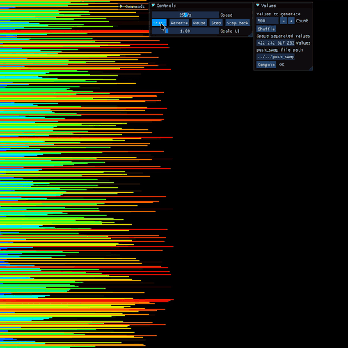
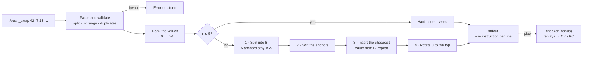

_This project has been created as part of the 42 curriculum by flomulle._

<div align="center">

# push_swap · 42 Paris

**Sorting integers with two stacks and 11 instructions, in as few operations as possible: a cost-based greedy algorithm that stays under the top-grade limits, and a checker that replays and verifies any solution.**


</div>

---

## Results

| | |
|---|---|
| **Final grade** | **125 / 100**, the maximum possible (mandatory part + bonus) |
| **Benchmark** | 100 numbers in **629** operations on average (limit 700), 500 numbers in **5,170** (limit 5,500) |
| **Correctness** | Every output verified by 42's reference checker and by my own: all 153 orderings of 1 to 5 numbers, plus 1,300 random runs of 100 and 500 |
| **Peer evaluations** | 3 / 3 passed at 125% |
| **Format** | Solo project, about 50 hours over 8 days (8 to 15 December 2025), five versions of the algorithm |
| **School** | 42 Paris, Common Core curriculum (completed) |

The bonus is only graded when the mandatory part is perfect, which for push_swap means the top score on every benchmark, so 125 means nothing failed anywhere.

What my evaluators wrote (translated from French):

> *"Great project, no leaks or problems found. Everything was well thought out and implemented, nothing to add. You deserve your star for writing a sort with 5 arguments, a perfect understanding of the exercise. Clear and precise explanation of the code, so: excellent. Good luck for what comes next!"*

> *"Perfect, the project is well executed and the bonus works well. Well done, and all the best for what comes next."*

> *"All good. Very clean work. Good luck!"*

During the defenses, one evaluator checked absolutely everything and took the time to discuss how I had built the algorithm. Another did their best to break the program, bonus included. The third went through my code to see how it works, and we discussed the best way to solve the problem. The full grade page, with the original comments, is in [assets/grade.png](assets/grade.png).

---

## Context: the 42 Common Core

42 is a software engineering school with no teachers, lectures or classes. Students learn by building projects, and every project is graded by other students through live code reviews and defenses.

The **Common Core** is 42's main curriculum. Students start it after passing the Piscine, a month-long selection bootcamp, and it typically takes 18 to 24 months. It is a series of projects grouped into ranks, and each rank must be completed before the next one opens. The projects start with C and Unix fundamentals, then cover algorithms, concurrency, system administration, networking, graphics and C++, and finish with a full-stack web application built as a team.

push_swap comes in the rank after [ft_printf](https://github.com/R-FLM/42_ft_printf), [get_next_line](https://github.com/R-FLM/42_get_next_line) and [Born2beRoot](https://github.com/R-FLM/42_Born2beRoot), and it is the curriculum's first algorithm project. The subject's stated focus is complexity: any sort is easy to write, but a solution that needs too many operations scores 0. It is built on my own [libft](https://github.com/R-FLM/42_libft), which by then included my ft_printf and get_next_line.

**I have completed the entire Common Core.**

---

Thanks to the [push_swap_visualizer](https://github.com/o-reo/push_swap_visualizer) of my fellow 42 student o-reo, here is a visualization of my sorting algorithm (each bar is a random value, a longer bar being a larger value):

<div align="center">



</div>

---

## Description

`push_swap` takes a list of integers as arguments. They form stack **A**, and stack **B** starts empty. The program prints the instructions that sort A in ascending order, one per line, using only these 11:

| Instruction | Effect |
|---|---|
| `sa` `sb` `ss` | Swap the top two elements of A, of B, or of both |
| `pa` `pb` | Move the top element of B onto A, or of A onto B |
| `ra` `rb` `rr` | Rotate A, B, or both: the top element goes to the bottom |
| `rra` `rrb` `rrr` | Reverse-rotate A, B, or both: the bottom element goes to the top |

The bonus, `checker`, takes the same list, reads instructions from standard input, executes them, and prints `OK` if A ends up sorted with B empty, `KO` otherwise. Both programs print `Error` on standard error for invalid input: something that is not an integer, a value outside the `int` range, or a duplicate.



---

## Skills demonstrated

| Area | What I did | Why it matters in production |
|---|---|---|
| **Algorithm design** | Combined a partition around the median, hard-coded cases for small inputs and a greedy, cost-based insertion into one strategy | Real problems rarely match one textbook algorithm. The skill is assembling the right pieces under the constraints |
| **Cost modelling** | Priced every candidate move (rotations in B, rotations in A, one push), took the cheapest, and recomputed after each move | The reasoning behind query planners and schedulers: estimate the cost of each option, take the cheapest |
| **Complexity analysis** | Showed why selection sort needs O(n²) operations, and measured the program's own O(n³) running time: doubling the input multiplies it by about 7.5 | Knowing how code scales before the input grows. The subject itself calls complexity a classic interview topic |
| **Iterating on measurements** | Wrote five versions in eight days, tested each on random inputs from my own generator, and kept or dropped ideas on their operation counts | Decisions backed by data instead of intuition |
| **Data representation** | Stored each stack as an array with a size instead of a linked list, and replaced every value by its rank so thresholds become arithmetic | The right representation makes the algorithm simpler. Ranking is the same trick as coordinate compression |
| **Input validation** | Rejected non-integers, values outside `int` and duplicates (including `0` and `-0`), and accepted numbers as separate arguments or in one quoted string | Command-line tools and services must never trust their input |
| **Testing against an oracle** | Ran every ordering of 1 to 5 numbers and 1,300 random runs, each output checked by 42's reference checker and by mine | Exhaustive small cases, random large ones and an independent checker: the standard way to test an algorithm whose output is easy to verify but hard to predict |
| **Simulation and validation** (bonus) | `checker` replays an instruction stream against a model of the stacks, verifies the final state and rejects any malformed line | The same structure as replaying an event log, or an interpreter for a small instruction set |
| **Code reuse and build** | The checker links the mandatory part's parsing, ranking and checks unchanged. The Makefile builds libft first and never relinks | One tested code base shared by two programs |
| **Memory management** | One array per stack, allocated once at full size, nothing allocated while sorting. Valgrind reports no leaks on 500 numbers, for both programs | Predictable memory use and no leaks |
| **Coding standards** | All 82 files pass `norminette` and compile with `-Wall -Wextra -Werror` | Working within a team's style guide and linters |

---

## How I got there: five versions in eight days

I kept a copy of the project each time I changed strategy. Re-running those copies on the same random inputs, through 42's reference checker, gives this history:

| Dec. 2025 | Version | Idea | 100 numbers | 500 numbers |
|---|---|---|---:|---:|
| 12 | 1 · Local rules | Choose each move from the top and bottom values only | not measured | not measured |
| 13 | 2 · Median partitioning | Quicksort across two stacks: split around the median, recurse on each half | never sorted | never sorted |
| 14, morning | 3 · Selection | Bring the smallest value to the top, push it to B, repeat | 1,493 | 32,251 |
| 14, afternoon | 4 · Bands | Push values to B in bands around the quartiles, pull back the ones that are close | 683, never finished | 3,798, never finished |
| 14 to 15 | 5 · Cost-based insertion | The final structure, with one bug | 626, 1 run in 20 unsorted | 5,200 |
| 15 | **Final** | | **629**, always sorted | **5,170**, always sorted |

**1 · Local rules.** My first idea was to decide each move from what was visible: swap if the top two were out of order, rotate if the top was larger than the bottom, push otherwise. I moved it to a scrap file the next day: with no plan beyond the next move, nothing bounds the number of operations. The same file holds my first attempts at estimating a median from 3 or 5 sampled values.

**2 · Median partitioning.** Next came quicksort adapted to two stacks: push everything below the median of A to B, then recurse on both halves. While debugging, I printed both stacks after every step, capped the recursion at 8 levels and ran everything under Valgrind. It handled 5 numbers but never fully sorted 100, and I dropped it the next morning for something simpler.

**3 · Selection.** The simplest correct strategy: bring the smallest value to the top in the shorter direction, push it to B, repeat, then push everything back. It always worked, but needed 1,493 operations for 100 numbers and 32,251 for 500, nearly 6 times the limit. Each value can cost up to n/2 rotations, so the total grows as n². Correctness was never the hard part. The rotations were.

**4 · Bands.** To shorten the rotations, I split the values into bands around the quartiles as I pushed them to B: the upper part of each band on top of B, the lower part rotated to its bottom, and the maximum kept in A. A second loop pulled values back when the top of B was within 3 of the top of A. It reached 683 operations for 100 numbers, but never finished sorting. Two of its ideas survived: splitting B around the median with `pb` and `pb rb`, and keeping the maximum in A.

**5 · Cost-based insertion.** That evening I replaced the second half completely. Instead of pulling back values that happened to be close, the program computes, for every value in B, what it costs to insert it at its place in A, and inserts the cheapest one. That gave the final structure and 626 operations for 100 numbers. About 1 run in 20 still came out unsorted: after rotating one of the values reserved for A, the loop pushed the next value without checking it, so a reserved value could end up in B. One `else` fixed it. And since the values were ranks 0 … n-1 by then, the median was simply (n-1)/2, so the function that sorted a copy of the stack to find it disappeared.

**Final.** On the 15th, I split the code to meet the Norm (at most 25 lines per function and 5 functions per file), then wrote the checker in the evening. It took under an hour, because it reuses the mandatory part's parsing, ranking and checks unchanged.

What this taught me:

- **Count operations, not just correctness.** Selection sort always worked and was still 6 times over the limit. Every later idea was judged on its operation count.
- **Write the simple, correct baseline early.** Selection sort was far too slow, but it gave a number to beat and a reference that always sorted.
- **Rare failures need many runs.** A bug that shows up once in 20 runs slips past a handful of manual tests, so the benchmark below uses 1,300.

---

## Technical overview

### Constraints

| Rule | Requirement |
|---|---|
| **Allowed functions** | `read`, `write`, `malloc`, `free`, `exit`, and my own libft and ft_printf |
| **Output** | Instructions separated by `\n` and nothing else. Nothing at all when no argument is given |
| **Errors** | `Error` followed by `\n` on standard error |
| **Benchmark** | Full marks, and access to the bonus: 100 numbers in fewer than 700 operations and 500 numbers in no more than 5,500 |
| **Compilation** | `cc -Wall -Wextra -Werror`, with a Makefile that must not relink |
| **The Norm** | 42's coding standard: at most 25 lines per function, 5 functions per file, 4 parameters, 5 local variables and 80 columns. No `for`, `switch` or `do…while` |
| **Global variables** | Forbidden |
| **Grading** | A crash, a leak, a Norm error, an unsorted result or too many operations gives the whole project 0 |

### The algorithm

Whatever the size, the program first **ranks the values**: each one is replaced by the number of values smaller than it, so any input becomes an ordering of 0 … n-1. The maximum is then n-1 and the median (n-1)/2, with no sorting needed to find them.

Up to 5 numbers, hard-coded cases take over: 2 operations at most for 3 numbers, and 10 for 5. Above 5:

1. **Split into B.** One pass over A. Five *anchors* stay in A: the values at 1/5, 2/5, 3/5 and 4/5 of the range, and the maximum. Every other value goes to B: above the median on top (`pb`), below it at the bottom (`pb` `rb`). B ends with large values near its top and small ones near its bottom, so most values are close to one end.
2. **Sort the anchors** with the 5-number routine. A is now a sorted skeleton spanning the whole range, and because it holds the maximum, every value in B has a place in A.
3. **Insert the cheapest value, and repeat until B is empty.** For each value in B, the cost is the rotations that bring it to the top of B, plus the rotations that bring its *successor* (the smallest larger value in A) to the top of A, each in the shorter direction, plus one `pa`. The cheapest value is pushed right above its successor, which keeps A in circular order. Then every cost is recomputed.
4. **Rotate A** in the shorter direction until 0 is on top.

<div align="center">


*A 500-number run in [push_swap_visualizer](https://github.com/o-reo/push_swap_visualizer): stack A on the left, B on the right, and a longer bar is a larger value. You can see the split into B, the insertions back into A, and the final rotation.*

</div>

### A run, step by step

With the 10 numbers `42 -7 13 0 99 -150 8 21 64 3`, this is the program's actual output, 36 instructions in all. Both stacks are shown top first:

| Step | Stack A | Stack B | Operations so far |
|---|---|---|---:|
| Input, as ranks | `7 1 5 2 9 0 4 6 8 3` | | 0 |
| 1 · Split: anchors 2, 4, 6, 8 and 9 stay in A | `2 9 4 6 8` | `5 7 1 0 3` | 13 |
| 2 · Sort the anchors | `2 4 6 8 9` | `5 7 1 0 3` | 18 |
| 3 · Insert 5 (cost 3) | `5 6 8 9 2 4` | `7 1 0 3` | 21 |
| 3 · Insert 7 (cost 3) | `7 8 9 2 4 5 6` | `1 0 3` | 24 |
| 3 · Insert 1 (cost 4) | `1 2 4 5 6 7 8 9` | `0 3` | 28 |
| 3 · Insert 0 (cost 1) | `0 1 2 4 5 6 7 8 9` | `3` | 29 |
| 3 · Insert 3 (cost 4) | `3 4 5 6 7 8 9 0 1 2` | | 33 |
| 4 · Rotate 0 to the top | `0 1 2 3 4 5 6 7 8 9` | | 36 |

Before the first insertion, the values in B cost 3 (for 5), 4 (for 7), 3 (for 1), 3 (for 0) and 3 (for 3). Value 5 is already on top of B and its successor, 6, is 2 rotations from the top of A, so it costs 0 + 2 + 1 = 3. On a tie, the first value found wins.

### Benchmark

Measured on the graded code with `make test`, using random values across the whole `int` range. Every output was checked by 42's `checker_linux` and by my `checker`.

| Numbers | Runs | Average | Worst | Limit | Runs within the limit |
|---:|---|---:|---:|---:|---:|
| 3 | all 6 orderings | 1.2 | 2 | 3 | 100% |
| 5 | all 120 orderings | 7.3 | 10 | 12 | 100% |
| 100 | 1,000 random | 629 | 709 | fewer than 700 | 99.6% |
| 500 | 300 random | 5,170 | 5,574 | 5,500 | 99.3% |

The limits for 3 and 5 numbers come from the evaluation sheet, the others from the subject. The averages sit 10% and 6% under the limits, but 4 runs in 1,000 at 100 numbers reached 700 or more, and 2 in 300 at 500 went over 5,500. An evaluation only tests a few random inputs. The first trade-off below is how I would remove that margin of risk.

An average run at 500 numbers is 4,176 single rotations, 994 pushes and 1 swap.

### Data structure

```c
typedef struct s_stack
{
	int		size;   // capacity: how many numbers were given
	int		index;  // how many values the stack holds right now
	int		*stack; // stack[0] is the top
	char	name;   // 'a' or 'b'
}			t_stack;
```

Each stack is a plain `int` array, an idea from the 42 Discord: it fits a stack better than a linked list, and needs one allocation instead of one per element. Both stacks are allocated at full size before sorting starts, so no allocation happens while sorting. For 500 numbers, the program allocates about 26 KB in total, three quarters of it while splitting the arguments.

### Implementation details

| Function | Detail |
|---|---|
| [`ft_parse_stack`](src/push_swap_parsing.c) | Two passes over the arguments. The first splits each one on spaces, validates and counts the numbers. The second fills an array allocated to the exact size. Duplicates are checked after conversion, so `0` and `-0`, or `5` and `+5`, count as the same value |
| [`ft_isint`](libft/src/ft_isint.c) | Checks the characters (an optional sign, then digits), then converts to a `long`, so values beyond `INT_MAX` or `INT_MIN` are rejected instead of wrapping around |
| [`ft_convert`](src/push_swap_utils.c) | Replaces each value by the number of values smaller than it. O(n²), done once |
| [`ft_sort_three_a`](src/push_swap_sort_small.c) | One branch per unsorted ordering of 3 values, 2 operations at most |
| [`ft_sort_small`](src/push_swap_sort_small.c) | For 4 or 5 values, pushes the smallest to B in the shorter direction, sorts the 3 left and pushes them back |
| [`ft_sort_a`](src/push_swap_sort.c) | The split: rotates past the anchors and pushes every other value to the top or the bottom of B |
| [`ft_closest`, `ft_distance_to_closest`](src/push_swap_sort_utils.c) | The cost model: prices each value in B and returns the cheapest |
| [`ft_index_closest_value`](src/push_swap_sort_utils.c) | Finds a value's successor in A, the smallest larger value |
| [`ft_sort_b`, `ft_sort_bis`](src/push_swap_sort.c) | Perform the rotations of B then A in the shorter direction, then `pa` |
| [`ft_execute`](src_bonus/checker_bonus.c) | Matches each instruction exactly, newline included, so `sa ` or `SA` is an error instead of being ignored |
| [`ft_process`](src_bonus/checker_bonus.c) | Reads standard input line by line with my get_next_line, and stops at the first invalid instruction |
| [Makefile](Makefile) | Builds libft through its own Makefile first. `checker` links every mandatory object except `push_swap.o`, which holds `main`. The bonus versions of the operations are copies that do not print, since bonus code must live in `_bonus` files |

### Design trade-offs and scope

- **Combined rotations are never used.** The cost adds the rotations of A and B as if they were separate operations, and the program never outputs `rr` or `rrr`. When both stacks rotate the same way, one `rr` does both, so the real cost is the larger of the two counts, not their sum. Taking that into account is the main improvement left, and would widen the margin under the limits.
- **Each instruction is O(n).** `stack[0]` is the top, so push and rotate shift the whole array. At 500 numbers this is invisible. A circular buffer would make every instruction O(1).
- **The program runs in O(n³).** Each insertion prices every value in B by searching both stacks, which is O(n²) per insertion. Measured: 0.19 s for 500 numbers, 1.3 s for 1,000, 9.6 s for 2,000. Storing each value's position instead of searching for it would remove most of that cost.
- **Unbuffered output.** Every instruction goes through ft_printf, which writes one character per system call: about 17,400 `write` calls for 5,100 instructions. A buffer flushed once at the end would cut that to a handful.
- **Greedy, not optimal.** Each insertion is the cheapest next move, not part of the cheapest sequence. A truly shortest solution needs a search over sequences, which is only practical for a few numbers.

---

## Instructions

**Requirements:** `cc` (gcc or clang) and `make`. `make test` also needs Python 3, and uses Valgrind if it is installed. Developed and tested on Linux.

```bash
git clone https://github.com/R-FLM/42_push_swap.git
cd 42_push_swap
make          # builds libft, then push_swap
make bonus    # also builds checker
```

Other rules: `test` (build both programs and run the test suite), `clean` (object files), `fclean` (object files, libft and both programs), `re` (rebuild from scratch).

### Usage

```console
$ ./push_swap 2 1 3
sa
$ ./push_swap 3 2 1 0
rra
pb
sa
rra
pa
$ ./push_swap "3 2 1" 0 | ./checker 3 2 1 0
OK
$ ./push_swap 1 2 two
Error
$ ./push_swap 1 2147483648
Error
$ ./push_swap 1 1
Error
```

Numbers can be passed as separate arguments, in one quoted string, or both. The first number is the top of the stack.

`checker` can also be used by hand: type instructions, one per line, then press `Ctrl-D`.

```console
$ ./checker 3 2 1 0
sa
rra
pb
KO
$ echo "sa " | ./checker 2 1
Error
```

### Testing

```bash
make test                                       # 33 checks, about 20 seconds on 12 cores
norminette src inc src_bonus inc_bonus libft    # every file passes the Norm
```

[test/push_swap_test.py](test/push_swap_test.py) checks error handling for both programs, sorts every ordering of 1 to 5 numbers, runs 1,000 random inputs of 100 numbers and 300 of 500 against the benchmark limits, and runs both programs under Valgrind. Every output is verified by `./checker`, and also by 42's `checker_linux` when it sits at the repository root. The script exits with an error if any check fails.

```
Random inputs, values across the whole int range
  100 numbers               1000 / 1000 sorted   avg    629   worst   709   99.6% < 700     OK
  500 numbers                300 / 300  sorted   avg   5170   worst  5574   99.3% <= 5500   OK

Memory
  push_swap                 500 numbers: no leak, no memory error                           OK
  checker                   500 numbers: no leak, no memory error                           OK

All 33 checks passed
```

With the default seed, it reproduces the [Benchmark](#benchmark) figures exactly. Options: `--seed` for other random inputs, `--runs 100 50` for a faster run, and `--push-swap` or `--checker` to test another implementation.

By hand:

```bash
ARG=$(shuf -i 0-99999 -n 500 | tr '\n' ' ')
./push_swap $ARG | wc -l             # number of operations
./push_swap $ARG | ./checker $ARG    # OK
```

### Visualizer

[push_swap_visualizer/](push_swap_visualizer/) is a copy of o-reo's [push_swap_visualizer](https://github.com/o-reo/push_swap_visualizer) (C++17, SFML and ImGui, GPL-3.0) with one fix: the original fails to build with GCC 14 and `-Werror`, so a `decltype(&pclose)` deleter is replaced by a lambda. It needs `cmake`, `g++` and the system packages listed in [its README](push_swap_visualizer/README.md). CMake downloads SFML and ImGui on the first build.

```bash
make                                  # the visualizer runs ./push_swap
cd push_swap_visualizer
mkdir -p build && cd build
cmake .. && make
./bin/visualizer
```

Its default program path, `../../push_swap`, leads from `build/` to this repository's `push_swap`, so it works as is. In the window, click **Compute**, then **Load** and **Start**.

---

## How this can be reused

1. **A test bench for sorting heuristics.** The cost model is three short functions in [push_swap_sort_utils.c](src/push_swap_sort_utils.c). Replacing them is enough to try another heuristic, for example one that counts `rr` and `rrr`, and `make test` measures the effect in seconds.
2. **An independent validator.** `checker` knows nothing about the sorting algorithm: it replays any instruction stream and checks the result, so it can validate any push_swap, mine or someone else's. A small, trusted simulator next to a complex solver is a pattern that works for any program that emits commands.
3. **Strict parsing of numeric arguments.** [`ft_parse_stack`](src/push_swap_parsing.c) turns `argv` into an array of validated, duplicate-free `int`s, whether the numbers come as separate arguments or in one quoted string. It fits any command-line tool that takes a list of integers.
4. **Rank normalization.** [`ft_convert`](src/push_swap_utils.c) maps any set of distinct integers to 0 … n-1 while keeping their order. Algorithms that need small, dense values, such as counting sort, radix sort or bucketing, can then work on any input range.
5. **A test suite for any push_swap.** Exhaustive small cases, random large ones and an independent checker on every output. `python3 test/push_swap_test.py --push-swap path/to/push_swap` runs the whole suite on another implementation.

---

## Resources

### References

- The push_swap subject, 42
- [Stack (abstract data type)](https://en.wikipedia.org/wiki/Stack_(abstract_data_type)), Wikipedia
- [Analysis of algorithms](https://en.wikipedia.org/wiki/Analysis_of_algorithms), Wikipedia
- [Quicksort](https://en.wikipedia.org/wiki/Quicksort), the partitioning behind version 2, and [Selection sort](https://en.wikipedia.org/wiki/Selection_sort), version 3, Wikipedia
- [Greedy algorithm](https://en.wikipedia.org/wiki/Greedy_algorithm), the idea behind the final insertion phase, Wikipedia
- The 42 Discord, push_swap channel, where I found the idea of storing each stack as an `int` array instead of a linked list
- [Stack Overflow](https://stackoverflow.com), when in doubt

### AI usage

- **DeepSeek**, to learn how a program can catch user input from standard input (`read(0)` in a `while (1)` loop), for the checker. I chose it because it shows its reasoning.
- No other AI tool was used for the project, and none of the code was generated. I learn more, and for longer, by struggling for hours or days to find ideas and debug my attempts.

---

## About this repository

```
.
├── inc/
│   └── push_swap.h       t_stack and every prototype
├── src/                  push_swap: parsing, ranking, the 11 operations, sorting
├── inc_bonus/
│   └── checker_bonus.h
├── src_bonus/            checker, and copies of the operations that do not print
├── libft/                My libft, with my ft_printf and get_next_line
├── test/
│   └── push_swap_test.py 33 checks: errors, every ordering of 1 to 5, 1,300 random runs, Valgrind
├── push_swap_visualizer/ o-reo's visualizer (GPL-3.0), with a one-line build fix
├── assets/               Grade screenshots and the visualizer GIF
└── Makefile
```

The program code is the graded version. After grading, I turned my benchmark into the test suite in [test/](test/), with a `make test` rule, added a `.gitignore` for the build folders, and included o-reo's visualizer with the fix described in [Visualizer](#visualizer).

If you are a 42 student, write your own version first: you will have to explain every line to your evaluators.

## Contact

- **[LinkedIn](https://www.linkedin.com/in/flmu/)**
- **[Email](mailto:fl.mu@outlook.com)**
- **42 intra:** `flomulle`
